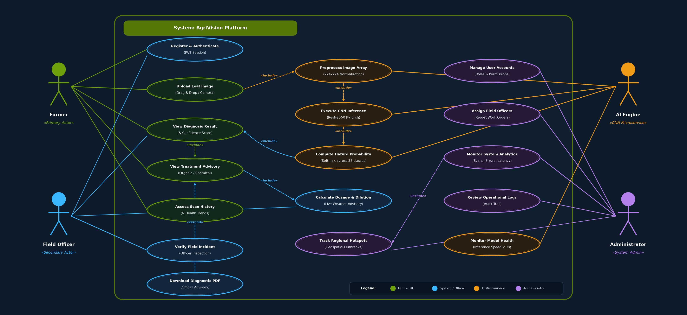

# 🌿 AgriVision: Product Specifications, System Architecture & Operational Workflows
**Enterprise Precision Agriculture & Foliar Pathology Diagnostic Platform**  
*MERN Stack (MongoDB, Express.js, React 18, Node.js) + PyTorch ResNet-50 AI Microservice*

---

## 📑 Table of Contents
1. [Executive Summary & Product Vision](#1-executive-summary--product-vision)
2. [Product Capabilities & Feature Matrix](#2-product-capabilities--feature-matrix)
3. [System Architecture & Microservice Interactions](#3-system-architecture--microservice-interactions)
4. [End-to-End Operational Workflows](#4-end-to-end-operational-workflows)
5. [Deep Learning AI Microservice (ResNet-50 Pipeline)](#5-deep-learning-ai-microservice-resnet-50-pipeline)
6. [Microclimate Weather & Disease Risk Index Engine](#6-microclimate-weather--disease-risk-index-engine)
7. [Agronomic Recommendation & Dilution Calculator](#7-agronomic-recommendation--dilution-calculator)
8. [Role-Based Access Control (RBAC) & User Workspaces](#8-role-based-access-control-rbac--user-workspaces)
9. [MongoDB Database Schemas & Data Model Specifications](#9-mongodb-database-schemas--data-model-specifications)
10. [REST API Specification & Integration Contracts](#10-rest-api-specification--integration-contracts)
11. [Unified Modeling Language (UML) Diagrams](#11-unified-modeling-language-uml-diagrams)
12. [Security, Privacy & Compliance Architecture](#12-security-privacy--compliance-architecture)
13. [Setup, Deployment & Production Runbook](#13-setup-deployment--production-runbook)

---

## 1. Executive Summary & Product Vision

### Problem Space
Global agriculture experiences an estimated 20% to 40% annual yield loss caused by plant pests and foliar pathogen infections. For smallholder and commercial farmers, traditional diagnosis relies upon sporadic physical visits by agricultural extension officers, leading to critical diagnosis delays, indiscriminate chemical application, ground-water contamination, and severe economic distress.

### Product Mission
**AgriVision** addresses this systemic bottleneck by delivering a decentralized, mobile-accessible, and highly intelligent precision agriculture platform. By synthesizing computer vision diagnostics (**ResNet-50 CNN**), live hyper-local weather intelligence (**Open-Meteo API**), and structured agronomic protocols, the application bridges the gap between field-level detection and immediate remedial action.

> **Product Philosophy: Actionable Intelligence**  
> Predicting a pathogen label alone is insufficient; farmers require immediate organic and chemical dilution steps, localized spray windows based on precipitation/wind speeds, and an escalation channel to certified agronomists.

---

## 2. Product Capabilities & Feature Matrix

| Feature Module | Target Persona | Business & Agronomic Value |
|---|---|---|
| **AI Foliar Scanner** | Farmer / Field Officer | Instant pathogen identification across 38 crop condition classes with confidence score in < 3s. |
| **Multi-Modal Camera Intake** | Mobile / Tablet Users | Native rear camera triggering (`capture="environment"`) and desktop WebRTC live viewfinder. |
| **Microclimate Weather & Risk** | All Personas | Live temperature, humidity, precipitation forecast, and automated fungal spore risk score. |
| **Treatment & Dilution Calculator** | Farmer / Extension Team | Precision chemical and bio-agent dilution ratios tailored to farm plot acreage and tank volume. |
| **Role Workspaces (RBAC)** | Farmer, Officer, Admin | Segregated portals for self-service diagnostics, field inspections, and regional outbreak surveillance. |
| **PDF Report & Export** | Farmer / Insurer | Exportable official diagnostic records supporting insurance claim verification and treatment audits. |

---

## 3. System Architecture & Microservice Interactions

AgriVision utilizes an enterprise-grade decoupled microservice architecture designed to prevent CPU-intensive AI inference from blocking user interface interactions and database operations.

```
                      +-----------------------------------+
                      |      React 18 SPA (Vite UI)       |
                      |  • Mobile Camera & WebRTC Scan    |
                      |  • Live Open-Meteo Weather Widget |
                      |  • Role-Based Workspaces          |
                      +-----------------+-----------------+
                                        | (REST / JWT)
                                        v
                      +-----------------------------------+
                      |    Node.js + Express API Gateway  |
                      |  • Port 4000                      |
                      |  • Role Middleware (RBAC)         |
                      |  • Image Proxy & Risk Indexing    |
                      +--------+-----------------+--------+
                               |                 |
       (Mongoose Document ODM) |                 | (Multipart Proxy)
                               v                 v
                 +-------------+----+     +------+--------------------+
                 |  MongoDB Database |     |  Flask AI Microservice    |
                 |  • crop_disease_db|     |  • Port 5000              |
                 |  • Users / Scans  |     |  • PyTorch ResNet-50      |
                 |  • Clinical Rx    |     |  • 38 Pathogen Classes    |
                 +-------------------+     +---------------------------+
```

### Operational Tiers
1. **Client Tier (Frontend):** Single Page Application (SPA) built with React 18, Vite, and Tailwind CSS. Provides instant UI reactivity, offline fallback caching, interactive Leaf Cam viewfinder, and role-routed workspaces.
2. **API Gateway Tier (Backend):** Node.js (v20+) and Express.js REST API gateway running on Port 4000. Handles JWT authentication, RBAC middleware, Multer image parsing, weather proxying, and Mongoose database operations.
3. **AI Diagnostic Tier (Microservice):** Isolated Flask service running on Port 5000. Houses the PyTorch ResNet-50 neural network weights (98.6 MB), executing high-throughput tensor transformations and returning top-1 class probabilities.
4. **Persistence Tier (Database):** MongoDB document database supporting document storage for Users, Prediction Scans, and Curated Disease Treatments. Includes an automatic fault-tolerant in-memory fallback during development.

> **Event-Loop Non-Blocking Architecture:**  
> The Node.js API Gateway proxies raw multipart image streams to the Flask AI service via internal HTTP pipelines. This completely shields the Node.js event-loop from synchronous tensor computations, maintaining sub-millisecond API response latency for dashboard queries.

---

## 4. End-to-End Operational Workflows

### Workflow A: Farmer Field Diagnostic & Treatment Journey
1. **Authentication:** Farmer logs in via JWT session or accesses 1-click evaluation profile.
2. **Microclimate Context:** The system checks geolocation via HTML5 Geolocation API; upon fallback, district presets (e.g. Chennai, Coimbatore, Bengaluru) populate microclimate data.
3. **Intake:** Farmer selects crop species (e.g., Tomato), specifies plot location, and captures foliage image via mobile rear camera or WebRTC viewfinder.
4. **Proxy Submission:** Client sends multipart/form-data payload to Express endpoint `/api/predict`.
5. **Gateway Routing:** Express validates payload (5MB limit, image MIME check) and forwards to Flask microservice at `localhost:5000/predict`.
6. **Inference Execution:** Flask pre-processes tensor (224x224 RGB, ImageNet normalized), runs ResNet-50 forward pass, and returns predicted class and confidence.
7. **Synthesis:** Express correlates disease label with MongoDB `treatments` collection, computes severity index, records report in `predictions` collection, and returns synthesized diagnosis.
8. **Actionable Resolution:** Client displays Results Modal containing severity badge, organic protocol, chemical dosage, spray window forecast, and export options.

### Workflow B: Extension Officer Incident Verification
1. Officer logs in and accesses the Officer Operational Dashboard (`/api/operations/reports`).
2. Dashboard renders a prioritized queue of pending farmer incident reports.
3. Officer inspects high-resolution foliage photograph, AI confidence score, and reported farm coordinates.
4. Officer submits professional validation (*Verified* / *Inconclusive*), appends physical soil/foliage field readings, and updates recommendations.
5. Farmer receives instant notification of report verification on their history log.

### Workflow C: Administrator Outbreak Surveillance & Governance
1. Administrator accesses the Admin Overview Portal.
2. Real-time metrics display total scanned samples, verified outbreaks, high-severity clusters, and system latency.
3. Admin reviews officer workload allocations and assigns specialized agronomists to high-risk outbreak clusters.
4. Admin manages platform user accounts and monitors Flask/Express microservice health via `/api/health`.

---

## 5. Deep Learning AI Microservice (ResNet-50 Pipeline)

The computer vision pipeline is built on the **ResNet-50 (Residual Network)** architecture, pre-trained on ImageNet and fine-tuned on the PlantVillage crop foliar pathology benchmark dataset.

- **Image Pre-Processing:** Torchvision transforms compose bilinear resize to 224x224 px, conversion to PyTorch Tensor, and channel normalization:
  - `Mean = [0.485, 0.456, 0.406]`
  - `Std  = [0.229, 0.224, 0.225]`
- **Pathology Coverage:** Supports 38 distinct classes including Apple Scab, Cedar Apple Rust, Corn Gray Leaf Spot, Grape Black Rot, Potato Early/Late Blight, Tomato Target Spot, and Healthy Crop baselines.
- **Inference & Confidence Scoring:** Softmax activation over logits produces normalized posterior probabilities. Scans returning < 60% confidence are flagged as ambiguous, advising user to capture closer foliage under balanced light.

---

## 6. Microclimate Weather & Disease Risk Index Engine

Fungal and bacterial sporulation is governed by ambient humidity, continuous leaf wetness duration, and temperature ranges. AgriVision queries the Open-Meteo Weather API without requiring API keys, computing a dynamic **Disease Risk Index (DRI)**:

1. **Humidity Factor:** Fungal sporulation surges when relative humidity exceeds 75% for > 6 hours.
2. **Temperature Threshold:** Pathogen germination accelerates between 18°C and 28°C.
3. **Precipitation Risk:** Rainfall washes off protective contact fungicides and spreads splash-dispersed spores.
4. **Spray Window Validation:** Spraying is discouraged when winds exceed 15 km/h (chemical drift risk) or rain is imminent within 6 hours.

---

## 7. Agronomic Recommendation & Dilution Calculator

To prevent chemical over-application and pesticide resistance, AgriVision features an interactive dilution calculator:
- **Concentration Balancing:** Calculates active ingredient in grams or milliliters per tank, guaranteeing adherence to Central Insecticide Board label limits.
- **Integrated Pest Management (IPM):** Provides bio-agent alternatives (*Bacillus subtilis*, *Trichoderma viride*, cold-pressed Neem Oil 10,000 ppm) alongside systemic synthetic chemistries.
- **Precautionary Directives:** Highlights mandatory protective personal equipment (PPE) and post-application harvest withholding periods (PHI).

---

## 8. Role-Based Access Control (RBAC) & User Workspaces

| Role Persona | Default Capabilities | Frontend Workspace View |
|---|---|---|
| **Farmer** | Scan leaves, review remedies, calculate dilution, browse scan history, download report. | `FarmerDashboard.jsx` |
| **Agricultural Field Officer** | View district queue, verify diagnoses, record physical field readings, adjust prescriptions. | `OfficerDashboard.jsx` |
| **System Administrator** | Platform analytics, user account management, officer task assignment, AI engine diagnostics. | `AdminDashboard.jsx` |

---

## 9. MongoDB Database Schemas & Data Model Specifications

### Collection 1: `users`
```json
{
  "_id": "ObjectId",
  "fullName": "String (required)",
  "email": "String (required, unique, indexed)",
  "passwordHash": "String (bcrypt, 10 rounds)",
  "role": "Enum ['farmer', 'officer', 'admin']",
  "createdAt": "Date (ISO 8601)",
  "updatedAt": "Date (ISO 8601)"
}
```

### Collection 2: `predictions`
```json
{
  "_id": "ObjectId",
  "userId": "ObjectId (ref: users, indexed)",
  "cropName": "String (e.g. 'Tomato')",
  "farmLocation": "String (e.g. 'North Acre - Sector 4')",
  "predictedDisease": "String (CNN class label)",
  "confidenceScore": "Float (0.0 to 1.0)",
  "severity": "Enum ['Low', 'Medium', 'High']",
  "status": "Enum ['pending_verification', 'officer_assigned', 'verified', 'action_completed']",
  "assignedOfficerId": "ObjectId (ref: users, optional)",
  "assignedOfficerName": "String (optional)",
  "adminNotes": "String (optional)",
  "fieldReadings": "Object (optional soil/leaf observations)",
  "scannedAt": "Date (ISO 8601, indexed)"
}
```

### Collection 3: `treatments`
```json
{
  "_id": "ObjectId",
  "diseaseName": "String (unique, matches predictedDisease)",
  "organicTreatment": "String (bio-agent & cultural protocol)",
  "chemicalTreatment": "String (fungicide/bactericide & dosage)",
  "preventionSteps": ["Array of Strings (preventive hygiene tips)"]
}
```

---

## 10. REST API Specification & Integration Contracts

| HTTP Method | Endpoint Path | Access Role | Description & Payload |
|---|---|---|---|
| `POST` | `/api/auth/register` | Public | Registers user `{fullName, email, password, role}` |
| `POST` | `/api/auth/login` | Public | Authenticates credentials; returns `{token, user}` |
| `GET` | `/api/auth/demo-accounts` | Public | Returns pre-seeded demo accounts for quick 1-click evaluation |
| `POST` | `/api/predict` | Authenticated | Multipart image upload + `{cropSpecies, farmLocation, notes}` |
| `GET` | `/api/history` | Authenticated | Returns authenticated user's scan history |
| `GET` | `/api/weather` | Authenticated | Accepts `?lat=&lon=&district=`; returns Open-Meteo metrics + DRI |
| `GET` | `/api/recommendations/advisories` | Authenticated | Returns disease treatment protocol + spray window advisories |
| `POST` | `/api/recommendations/calculate-dosage` | Authenticated | Accepts `{acres, tankCapacity, chemicalType}`; returns dilution math |
| `GET` | `/api/operations/reports` | Officer / Admin | Returns district reports for verification |
| `PATCH` | `/api/operations/reports/:id/verify` | Officer / Admin | Updates report status and attaches field inspection readings |
| `GET` | `/api/health` | Public | System diagnostic check (MongoDB status, AI microservice status) |

---

## 11. Unified Modeling Language (UML) Diagrams


*Figure 1: Official UML 2.5 Use Case Diagram for AgriVision Precision Agriculture Platform*

---

## 12. Security, Privacy & Compliance Architecture

1. **Cryptographic Password Hashing:** Passwords salted with 10 rounds of bcrypt prior to database write. Plaintext credentials are never retained in memory or logs.
2. **Stateless JWT Authorization:** Stateless authentication via cryptographic JWT tokens bearing user ID and role claims, expiring after 7 days.
3. **Role-Based Access Control (RBAC):** Custom `requireRole` middleware intercepts restricted operational endpoints (`/api/operations/*`), denying unauthorized privilege escalation.
4. **Upload Payload Hardening:** Strict Multer file memory storage filters reject payloads > 5 MB or files with invalid MIME types, mitigating image-buffer injection attacks.
5. **CORS & Environment Hygiene:** CORS policies configured to validate cross-origin requests; sanitized environment variables prevent cloud credential exposure.

---

## 13. Setup, Deployment & Production Runbook

### Service 1: AI Microservice (Port 5000)
```bash
cd ai_service
pip install -r requirements.txt
python app.py
```

### Service 2: Node.js Backend Gateway (Port 4000)
```bash
cd server
npm install
node server.js
```

### Service 3: React Vite Frontend (Port 5173)
```bash
cd client
npm install
npm run dev
```

Open **`http://localhost:5173`** in your browser.
